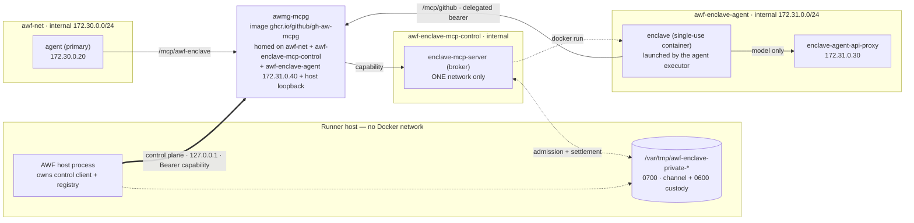

# Unified Enclave Architecture

The [Filesystem Sharing Contract](filesystem-sharing-contract.md) records
private-path sharing boundaries, identities and verification gaps across
enclave backends.

## Status

Layer 5 establishes one `enclaves` subsystem, one AWF-owned MCP server, and mcpg-only access through the compiler handoff contract.

Run configuration now requires one workload sandbox backend for the primary and
all enabled enclave executors. Omitted enclave runtimes inherit the primary
selection (Docker/runc by default); explicit conflicts fail before staging or
startup. Each workload remains a separate isolated instance, and supporting
Docker infrastructure is not part of this constraint. Cloud Hypervisor
primary-with-enclave execution is still gated pending lifecycle integration;
NVX enclaves remain unsupported. The host-executor machinery described below is
preserved, but Docker-primary/Cloud-Hypervisor-enclave runs are no longer accepted.

Dynamic repository admission described below is implemented and version-gated.
It runs only when the gh-aw compiler starts mcpg's
`github-repository-delegation-v1` controller (mcpg v0.4.18 or newer) and hands
AWF its loopback-only control endpoint and AWF-only control capability; every
other combination fails closed before execution. Static entries continue to
declare a non-empty `repos` list and use immutable seeds.

v0.4.18 is the floor, not v0.4.17, because the delegation duration fields are
whole seconds on the wire. v0.4.17 declared `max_identity_ttl` and
`requested_ttl` as Go `time.Duration` and so decoded them as **nanoseconds**;
v0.4.18 added `internal/delegation/wire.go`, which decodes both as `int64`
seconds. Pairing current AWF with v0.4.17 would silently reinterpret a
120-second TTL as 120 nanoseconds. gh-aw pins the matching default in
`pkg/constants/version_constants.go` (`DefaultMCPGatewayVersion`).

Explicit Cloud Hypervisor enclave selection routes through the trusted host
executor under [ADR 0002](adr/0002-cloud-hypervisor-enclave-executor.md).
AWF derives run state from validated configuration and staged seeds, verifies
host/artifact prerequisites, and constructs one authenticated private Unix
listener before starting the broker. Only the broker mounts the client channel;
it receives neither the host recovery journal nor launch controls, Docker socket,
or repository seed trees. Protocol v2 and its settlement contract are unchanged.
Static script and static agent entries are the initial scope. Dynamic admission,
custom images, mixed container/VM enclave runtimes, split-filesystem Docker,
primary sbx/NVX/Cloud Hypervisor combinations, and static GitHub tools without a
scoped executor bearer handoff fail closed.

Production admission also requires the trusted aggregate writable-storage
provider from [#9394](https://github.com/github/gh-aw-firewall/issues/9394).
AWF supplies the production provider only on eligible GitHub-hosted Ubuntu
x86_64 hosts with privileged KVM access and writable cgroup v2. Unsupported
hosts retain the missing-prerequisite error before staging or constructing a
listener or VM. No configuration/environment switch bypasses it, and AWF never
falls back to a different runtime. Each invocation owns one kernel-bounded
allocation domain for writable guest exports: script 1 GiB, agent 512 MiB.
Exports, request and handoff state all consume that
same capacity, including sparse-file allocations and concurrent writers.
Artifact snapshots use a separate root-owned, host-only 2 GiB tmpfs beneath the
allocation root, sharing the preflight artifact budget but not the writable-state
filesystem. Executable snapshots are sealed read-only and never exported as
writable guest storage; writable state remains `noexec`. Rootfs preparation
and final image/VM run-state each use another independent 2 GiB `noexec` tmpfs,
allowing all three full images to coexist without charging guest exports.
The enclave root disk remains guest-read-only. All four filesystems retain
invocation-private propagation, exact capacity/device verification, identity
journaling, sealing, cleanup and dead-owner recovery.
Preflight captures immutable artifacts in short-lived domains before attestation
or executable probes; invocation copies are checked against those digests.
Host-only mount points use the trusted `/var/lib/awf-cloud-hypervisor/host-invocations`
tree, not the broker's `/var/tmp` work directory. Allocation roots and mount
points must remain outside all primary-agent mounts.
The host lifecycle closes admissions before broker shutdown,
then cancels/closes the executor before releasing storage or deleting private
state. Unresolved cleanup preserves recovery records and prevents deletion.

## Cross-backend workload contract

This is the characterization baseline for shared-core extraction and conformance
work, not an authorization to enable additional backends. **I** means implemented
on the accepted path (not universal live certification); **G** means implemented
behind preview/prerequisite or named acceptance gates; **U** means unsupported
and rejected; **V** means unverified by real-backend acceptance. A profile, mock,
runner specification, or successful structural validation alone cannot promote
G/U/V to I. Matrices below describe admission; the verification table describes
what evidence supports it. Existing Docker capabilities must survive extraction.

### Roles and execution combinations

| Role | Observable contract | Security boundary |
| --- | --- | --- |
| Primary agent | Runs the caller's command with the approved workspace, environment, proxy routes and workdir; streams command output and returns its exit status. | Primary workspace is not a private repository seed. No enclave-private roots, enclave credentials, broker capability, ledger, or recovery journal. |
| Script enclave | One bounded Python invocation over one immutable repository seed; only a validated canonical result crosses back. | No network, read-only root/seed, invocation-private writable state, non-root identity; no primary workspace. |
| Agent enclave | One bounded, trusted-model invocation, over a static seed or authorized dynamic repository identity. | Dedicated credential-injecting API proxy only, plus compiler-authorized GitHub MCP when configured; no general internet, primary proxy, Squid, safe outputs, or primary workspace. |

“Script-only” and “agent-only” mean only that enclave executor is enabled; the
normal CLI still has a primary agent. They do **not** describe a new standalone
enclave CLI. Direct host-executor tests exercise a different, trusted seam.

| Combination | Docker | NVX | Cloud Hypervisor |
| --- | --- | --- | --- |
| Primary-only | I | G: explicit preview, host/artifact/security preflight | G: explicit preview, eligible host/artifacts |
| Primary + script-only | I | U | G: named public-fixture acceptance only; general use U |
| Primary + agent-only | I: Copilot and configured route | U | G: named public-fixture acceptance only; general use U |
| Primary + both enclave roles | I: shared ledger/admission lane | U | G: release conformance harness only; general use U |

Admission sources are `src/enclave/{run-backend,preflight}.ts`,
`src/nvx/runtime-validation.ts`, and
`src/cloud-hypervisor/runtime-validation.ts`. Cloud Hypervisor exceptions are
closed predicates in
`src/enclave/cloud-hypervisor-{script,conformance}-acceptance.ts`, not a general
opt-in: workflow identity/ref, repository/sensitivity, artifact/image alignment,
executor settings and budgets must match. The script/Copilot smoke exceptions
and release conformance exception have different predicates; neither grants
private-repository acceptance. `assertCloudHypervisorWorkloadLaunchable` also
requires trusted enclave-executor authorization. Its boolean is not a user flag.

Exactly **one workload backend per run** covers the primary and every enabled
executor. Omitted runtimes inherit the primary; Docker/runc and gVisor/runsc are
aliases within their respective backends, not equivalent to each other.
Supporting Docker proxy/broker infrastructure does not make a VM workload a
Docker workload. Unknown selections, backend mismatches, missing prerequisites and
launch failures must fail closed, except for the existing Cloud Hypervisor
primary-only fallback: an eligibility/preflight `CloudHypervisorUnsupportedHostError`
logs a warning, clears the selected runtime and continues on Docker
(`src/commands/validators/config-assembly.ts`, `src/commands/main-action.ts`).
This exception never applies with enclaves; artifact-trust failures stay fatal,
and NVX never falls back. Functional/policy parity does **not** make
containers, user-space kernels and hardware VMs equivalent isolation boundaries.

### Capability inventory

| Capability | Docker | NVX | Cloud Hypervisor |
| --- | --- | --- | --- |
| Static repository seeds | I: script and agent; merged trusted catalog | U: no enclave runtime | G: host executor implemented; public acceptance scope above, private acceptance V |
| Dynamic repositories | G: agent only, compiler delegation handoff and supported mcpg required | U | U: preflight rejects |
| Static GitHub tools | G: compiler-scoped identity, `list_issues` / `issue_read`; legacy `issues-read-v1` retained | U for enclaves | U: scoped executor bearer handoff missing on accepted host path |
| Dynamic GitHub tools | G: `github-repository-read-v1`, one repository per invocation | U | U |
| Enclave engines | I: Copilot only; other engine names are parsed but rejected | U | G: Copilot in acceptance fixtures; other engines rejected despite wider profile types |
| Primary engines/commands | I: arbitrary installed command, provider routes as configured | G: guest-installed commands, approved environment/routes | G: guest-installed commands, approved environment/routes |
| Trusted custom enclave images | I: script/agent image override retained; does not implement another engine | U | U: requires AWF-attested enclave artifacts |
| Primary images/tool availability | I: existing local-build, registry/tag and agent-image options | G: explicit distro layer; not OCI image parity | G: attested rootfs/supervisor; not OCI image parity |
| Host requirements | Docker daemon and existing platform/runtime prerequisites | Linux x86_64, KVM, local host-visible infrastructure, required tools/cgroup/artifact preflight | GitHub-hosted Ubuntu x86_64, KVM, local Unix Docker socket, writable cgroup v2 and trusted enclave storage provider |
| Artifact provenance | Existing OCI/local-build trust model; no new VM-attestation requirement imposed on Docker overrides | Manifest + attestation bundle, pinned upstream NVX/OpenVMM provenance, artifact digests | Release manifest + bundle + expected tag, common/enclave artifact verification and immutable snapshots |
| TTY, DinD/split filesystem, host access, extra host binds | Existing primary capabilities retained; DinD/socket-exposing binds rejected with enclaves | U | U on primary preview |
| Custom subnet / DoH / DIFC | Existing Docker options retained | U | Fixed microVM infrastructure subnet; primary DoH/DIFC U |

Inventory evidence: `src/enclave/preflight.ts`,
`src/types/enclave-options.ts`, `src/nvx/{preflight,artifact-manifest}.ts`,
`src/cloud-hypervisor/{preflight,artifact-trust,enclave-artifact-manifest}.ts`,
and the runner specs under `containers/enclave/{script,agent}-executor/`.
The Cloud Hypervisor common-artifact development bypass is separately guarded,
requires explicit digests and host authorization, and is not an enclave
acceptance bypass. Parsed engine/profile names or reference GitHub data-plane
profiles do not override the stricter preflight inventory.

### Shared invariants and verification obligations

Each row identifies deterministic evidence and a real-backend check for the
future shared conformance suite. Paths in this table are repository-relative;
tests under `src/` run with the root Jest configuration. Live checks must use
disposable fixtures and the final workload identity, not privileged `docker exec`.

| Invariant | Existing deterministic evidence | Required real-backend evidence / gap |
| --- | --- | --- |
| Primary workspace and workdir | `src/services/agent-volumes*`, `src/nvx/{workspace-export,runtime-validation}.test.ts`, `src/cloud-hypervisor/exports.test.ts` | Read/write round trip and denied sibling/alias access. Docker preserves host workspace paths; VMs export `/workspace`. NVX rejects outside/escaping-symlink workdirs. Verify backend-specific path mapping, not identical mount layouts. |
| Primary environment and proxies | `src/services/agent-environment-{credentials,proxy}.test.ts`, `src/microvm/guest-environment.test.ts`, `src/cloud-hypervisor-runtime-backend.env-mapping.test.ts`, `src/nvx/guest-entrypoint.test.ts` | Verify explicit env/env-file/env-all precedence, reserved guest HOME/PATH/proxy handling, allowed/denied egress and absent provider secrets with API proxy enabled. VM tool caches are read-only seeds, not live Docker home shares. |
| Primary status, output, cancellation | `src/run-agent-command.test.ts`, `src/commands/signal-handler.test.ts`, `src/{cloud-hypervisor-runtime-backend,nvx/runtime-backend}.test.ts` | Command exits 0/nonzero, streams stdout/stderr, then interrupt an active command and verify guest/process/resource teardown. NVX is one-shot; Cloud Hypervisor uses supervisor requests; do not invent common TTY or signal-number semantics. |
| Script no-network | `src/enclave/script-runner-spec.test.ts`, `src/cloud-hypervisor/enclave-network.test.ts`, `src/cloud-hypervisor/workload-profile.test.ts` | Deny IPv4/IPv6, DNS, direct IP, proxy and host-service connections. Docker uses `--network none`; Cloud Hypervisor omits NIC and creates only an empty network namespace. NVX enclave checks unavailable. |
| Agent dedicated proxy and authorized GitHub only | `src/enclave/{agent-runner-spec,github-gateway,preflight}.test.ts`, `src/cloud-hypervisor/enclave-network.test.ts` | Assert exact peer set, deny primary/Squid/internet and unauthorized repo/tool calls; no provider key in workload. VM static GitHub admission remains U even if network profiles validate. |
| Immutable seed, private invocation state, non-root identity | `src/enclave/{staging,invocation-staging,mount-policy}.test.ts`, `src/cloud-hypervisor/{enclave-export-plan,workload-profile}.test.ts` | Attempt seed/root writes and cross-invocation reads; inspect UID/GID, groups, capabilities and denied host paths. VM profile fixes enclave UID/GID 65534; do not infer live DAC from export metadata. See filesystem contract for remaining identity gaps. |
| Aggregate storage and resource limits | `src/enclave/execution-policy.test.ts`, runner-spec tests, `src/cloud-hypervisor/{enclave-storage,trusted-enclave-storage}.test.ts` | Multi-file/concurrent/sparse writers across every writable export; memory/process/CPU exhaustion. Privileged storage integration tests are separate from mocked policy evidence. Docker host-output confinement has real-daemon fixture evidence; live Copilot combinations remain V. See the Docker acceptance scope below. |
| Canonical bounded results | `src/enclave/invocation-result.test.ts`, `src/bounded-execution/finite-disclosure-*.test.ts`, `src/enclave/host-executor-protocol.test.ts` | Malformed/oversized/non-UTF-8/wrong-schema output, symlink/special-file outputs, private stdout/stderr: only canonical approved result or non-disclosing error may reach primary. |
| Cleanup before release and recovery | `src/enclave/{runner-lifecycle,host-executor-lifecycle,host-executor-journal,host-executor-broker}.test.ts` | Hold/fail cleanup and verify no success release; kill launcher/broker, restart/reconcile, verify owned resources reaped and unrelated resources untouched. Preserve protected state on uncertain cleanup; no blanket private-directory deletion. |
| Private-output handling | `src/enclave/{agent-session-artifact,proxy-debug-retention,public-debug}.test.ts`, `src/protected-command-output-capture.test.ts` | No seed/request/session/raw guest output in primary mounts or public artifacts; inspect retained evidence ownership/modes. Public-fixture debug requires trusted positive visibility authorization and is not private-output permission. |
| Disclosure and operational budgets | `src/enclave/{information-budget,tool-call-budget,mcp-server,dynamic-registry}.test.ts`, `src/enclave/proxy-usage.test.ts` | Retry, restart, alternate roles and concurrent calls must not refill balances; proxy accounting and delegated identity revocation need live evidence as well as broker tests. |

The current live harness entry points include
`scripts/ci/cloud-hypervisor-live-smoke.sh`,
`scripts/ci/cloud-hypervisor-enclave-live-smoke.js` and
`scripts/ci/cloud-hypervisor-enclave-release-gate.js`; their presence is a
verification strategy, **not** a claim that all release-attested cases passed.
NVX phase acceptance and Docker integration evidence must likewise be recorded
per host, artifact set, role and combination. No full cross-backend conformance
certificate is asserted here.

### Resource-limit semantics

Limits are scoped and must not be conflated:

- Docker enclave runner specs apply trusted configurable memory, CPU, PID and
  tmpfs limits with read-only rootfs, dropped capabilities and no-new-privileges.
  Host-owned Docker execution additionally places every writable invocation bind
  (result, agent session and agent runtime) on one private, verified host tmpfs.
  Its capacity and all container tmpfs/shm capacities are counted together;
  per-file limits alone are not aggregate enforcement. Docker retains its own
  resource configuration and audited launcher identity, not the fixed VM policy.
- VM host-enclave policies in `src/enclave/execution-policy.ts` are fixed:
  both roles have 768 MiB memory, one vCPU with 500 milli-CPU quota, 47 processes,
  1024 open files and UID/GID 65534. Script/agent tmpfs limits are 256/96 MiB;
  **per-file** limits are 512/256 MiB; **aggregate writable-state** limits are
  1024/512 MiB respectively. These are not the Docker parser defaults and must
  not silently replace Docker's configurable limits during extraction.
- `src/enclave/bounded-storage.ts` requires verification of actual confinement
  and capacity. The Cloud Hypervisor provider uses an invocation-private
  kernel-bounded allocation domain across request/handoff, output, runtime and
  session exports. Host-only executable snapshots, rootfs preparation and VM
  image state use separately bounded domains described in Status above; they
  are not writable guest exports. A nominal rootfs/image size, disk free-space
  measurement, sparse logical size, `RLIMIT_FSIZE`, or per-file cap is **not**
  aggregate enforcement. Test allocated blocks, simultaneous writers and
  alternate writable paths; reject absent/unverifiable providers before launch.
- Primary VM memory/vCPU/host-cgroup limits and enclave limits have different
  scopes. Neither a VM memory setting nor its VMM cgroup establishes a guest
  storage quota or charges external proxy services to that workload.

### Disclosure, invocation and delegation semantics

These are independent controls; none substitutes for another:

- One per-run repository ledger is shared across script and agent calls.
  `internal` gets 64 bits, `confidential` 8, `sealed` 0; `public` and `trusted`
  are unmetered. Finite schema cardinality, status and timing are charged under
  the finite-disclosure policy; public still requires a finite schema, while
  trusted may use bounded free-form strings. Sealed cannot fund a launch.
  Accepted queries reserve disclosure before private execution; errors do not
  create a free retry channel. Re-admission never refills a repository balance.
- `maxInvocations` is an executor-local response/admission counter, not just a
  successful-launch count: handler rejections also consume it. Optional run-wide
  `rateLimiting.maxNumToolCalls` counts attempted calls across both tools, including
  invalid, failed and busy-lane calls. Successfully persisted counts are restored
  for the same run, but persistence is best-effort: write failures only warn, and
  unreadable or corrupt state starts at zero, so a restart can refill the cap.
  Exhaustion has its existing explicit in-band cap message; it is not the generic
  private error. The shared single-call admission lane prevents simultaneous
  private queries. The information ledger and executor invocation counter are
  in-memory broker state; cross-restart preservation of those balances remains V.
  Tool-call accounting also lacks a fail-closed persistence guarantee.
- Optional model-request/token limits are enforced by the dedicated API proxy
  using invocation-bound capabilities and conservative reservations/accounting;
  the guest receives no signing secret/provider credential. Missing usage is
  not proof of zero usage. These budgets differ from result bytes, disclosure
  bits, execution deadlines and tool-call counts.
- Dynamic admission is agent-only, mutually exclusive with static `repos` in
  an entry, and requires the compiler's private delegation-control handoff
  (mcpg v0.4.18+). Exact canonical repository selectors must satisfy the trusted
  owner/repository, sensitivity, tool and quota envelope. Reserve worst-case
  invocation/output/time quotas before execution, mint a short-lived
  one-repository identity, revoke on completion/cancellation, and retain
  non-refilling run accounting. No fallback to static seeds, job-lifetime
  identities or broader policy on handoff/admission/revocation failures.
- Static seed exposure is one repository per invocation, but existing static
  GitHub MCP identities cover the configured repository union. Do not silently
  advertise the dynamic one-repository identity guarantee for static tools.
  Host protocol retries bind to invocation/request digests and settlement;
  transport retries must not become new unaccounted private executions.

Intentional differences above remain until separately reviewed and accepted.
In particular NVX enclave integration, general Cloud Hypervisor combinations,
private-repository VM acceptance, production Docker primary/enclave combinations,
and complete live identity/resource/recovery evidence are not supplied by this
characterization. Shared extraction must preserve supported Docker behavior
while leaving these restrictions fail closed.

## Architecture

AWF stages immutable repository seeds on the host, starts one AWF-owned `enclave-mcp-server`, and exposes enabled executors only through `gh-aw-mcpg`.

- **Script executor** — `enclave_run_script` runs a bounded Python script in a no-network, read-only, single-use sandbox.
- **Agent executor** — `enclave_run_agent` runs the pinned Copilot engine in a bounded single-use enclave. Its mandatory peer is the dedicated API proxy; `agent.tools.github` (or the deprecated legacy `agent.github.cli: issues-read-v1` marker) also permits a direct connection to compiler-owned shared mcpg.
- **Shared controls** — the `repos` lists of the `enclaves` entries form the only trusted repository catalog; script and agent calls debit the same per-run repository ledger and share one admission lane.

> **Terminology.** *Executor* and *enclave* are distinct, and this document uses
> both. An **executor** is trusted execution machinery and a configuration kind:
> `enclaves.executors.{script,agent}`, `executorKind`, and the code under
> `containers/enclave/{script,agent}-executor/`. Docker launch authority now
> belongs to the AWF host; the broker retains admission/accounting metadata and
> only an authenticated executor channel, not the Docker socket or seed trees.
> The unmigrated gVisor broker still uses the audited container runners directly.
> An **enclave** is the
> ephemeral container an executor launches per invocation — its own image
> (`enclave-script` / `enclave-agent`), its own name
> (`awf-enclave-agent-<run>-<invocation>`), and its own entrypoint. One executor
> launches many enclaves; the executor is trusted, the enclave is not. Where
> prose says "single-use executor" it means the enclave that executor launched.
> `executor_bearer` is mcpg's wire field name and is never renamed.

The primary agent never receives a broker socket, wrapper binary, direct MCP server URL, capability, repository seed, ledger state, or alternate transport.

Repository admission has two modes, both served by this same MCP backend:

- **Static seed-backed mode** — the existing `repos` lists in enclave entries
  form the trusted repository catalog. AWF stages immutable seeds for that
  catalog before primary-agent work begins. Each invocation selects one catalog
  entry and exposes only that repository seed to the single-use executor. Static
  GitHub-enabled agent enclaves keep their current job-lifetime mcpg identity,
  which covers the union of configured repositories; they do not claim the
  dynamic mode's one-repository GitHub-MCP identity guarantee.
- **Dynamic GitHub-MCP-backed mode** — the compiler provides a closed policy
  envelope instead of enumerating repository seeds in workflow frontmatter. Each
  invocation provides only a canonical `owner/repo` selector, bounded
  agent prompt, and finite response schema. AWF admits at most one repository
  for that invocation, mints exactly one short-lived
  `github-repository-read-v1` identity for it through mcpg's private control
  channel, and hands the single-use executor only that identity's bearer.

Static and dynamic modes are compatible in one workflow run but mutually
exclusive within a single enclave entry: an entry declares either static `repos`
or a dynamic repository policy. Caller-controlled repository names are never
interpreted as policy. They cannot alter sensitivity, tools, credentials,
runtime, model, image, network, filesystem, resource limits, timeouts, or
quotas. The one-repository guarantee applies to dynamic admissions and to static
seed exposure, not to existing static GitHub MCP identities unless static mode
later adopts per-invocation repository-scoped identities. Cross-repository
aggregation occurs only in the primary agent by combining multiple bounded
enclave results.

## Tool contracts

### Session audit log redaction

Every enclave invocation writes a bounded, per-invocation transcript
(`session.jsonl`) inside the enclave. Host-owned Docker execution keeps this
file inside the bounded private allocation and destroys it during cleanup;
it is not returned through the host protocol or exported as an artifact.
On the legacy container-runner path, the broker copies it verbatim into
`<auditDir>/enclave-agent-sessions/<invocationId>.jsonl` and the CLI exposes
under `sandbox/firewall/audit/enclave-agent-sessions/` when audit artifacts
are preserved or uploaded. Because the enclave can read confidential
repository content under the invocation's disclosure budget, this transcript
crosses the enclave boundary and must never carry that content past it.

The enclave entrypoint (`containers/enclave/agent-entrypoint.py`) enforces
this by construction:

- Lifecycle events (`progress`, `session`, `preflight`, `resource-snapshot`,
  `operation-error`, `failure`, `success`) only ever contain fixed
  identifiers, exit codes, byte counts, durations, and sanitized OS error
  categories — none of these fields carry free-form enclave output.
- Events that would otherwise carry free-form text — `engine-result`'s
  `stdout`/`stderr` and `engine-diagnostics`'s `log` (raw Copilot CLI output,
  which can include tool results, file contents, or model transcripts) — are
  replaced by default with `{ bytes, sha256, sensitivity: "redacted" }`. The
  byte count and hash are enough to correlate identical failures across
  invocations without disclosing their contents.
- Raw (but still secret-redacted via `redact_diagnostics`) text is restored
  only when the broker sets the privileged, non-caller-controlled
  `AWF_ENCLAVE_AGENT_DEBUG_RAW_SESSION_LOGS=true` environment variable on the
  enclave container. AWF does not set this variable anywhere by default, so
  raw enclave engine output never leaves the enclave unless an operator
  deliberately wires up that opt-in for local debugging. The broker marks
  these transcripts and segregates them under its private
  `raw-debug-sessions/` directory instead of `sessions/`; the CLI's audit
  collector copies only `sessions/`, so raw-debug transcripts are never
  included in the normal workflow artifact path.
- This redaction applies uniformly on every exit path: normal completion,
  timeouts, cancellations, engine failures, malformed output, and
  configuration errors all route through `append_engine_result`,
  `read_copilot_diagnostics`, or the fixed `failure`/`operation-error`
  shapes above, so there is no code path that appends raw enclave text to
  the transcript.

The only free-form, repository-derived value that is allowed to leave the
enclave through a different channel is the broker-validated bounded result
written to `/awf/out`, which is checked against the caller's declared JSON
schema and disclosure budget before it is returned to the caller — never
through the audit transcript.

See `src/enclave/agent-entrypoint-diagnostics.test.ts` and
`src/enclave/agent-session-artifact.test.ts` for coverage of the
default-redacted, privileged-opt-in, and artifact segregation behaviors.

The AWF-owned MCP server publishes only the enabled enclave tools:

```text
enclave_run_script({
  privateRepo: "owner/repo",
  schema: <finite disclosure schema>,
  script: <bounded UTF-8 Python source>
})

enclave_run_agent({
  privateRepo: "owner/repo",
  schema: <finite disclosure schema>,
  prompt: <bounded UTF-8 task prompt>
})
```

Both tool schemas are closed (`additionalProperties: false`). Callers cannot provide images, runtimes, models, profiles, prompts beyond the bounded payload field, repository catalogs, credentials, timeout overrides, or any other trusted control.

The server speaks a fixed, tiny subset of MCP (`initialize`, `tools/list`,
`tools/call`) across the `2025-06-18` and `2025-11-25` revisions, so
`initialize` echoes back whichever of those the client requested and otherwise
answers with the newest supported revision (`2025-11-25`). It does not advertise
`2025-03-26` because that revision requires JSON-RPC batch handling, which this
server does not implement. Newer clients — for example Copilot CLI 1.0.83,
which negotiates `2025-11-25` — therefore complete initialization instead of
failing version negotiation and building their tool surface from a failed
`tools/list`.

When an `enclave_run_agent` invocation has GitHub MCP access (static or
dynamic), the trusted executor appends repository-scope instructions after the
caller's prompt: every GitHub MCP request must set `owner` and `repo` to the
repository selected for that invocation, and wildcard selectors and
repository-discovery tools are forbidden. The text is generated from the
host's admitted seed catalog or dynamic selector for Docker (the broker's
validated selector for legacy gVisor), never from caller text, so it cannot broaden
access. It is a prompt-level mitigation only — mcpg's `allow-only` enforcement
remains the security boundary. Static GitHub authority covers the configured
repository union; those instructions do not make it a dynamic, one-repository
delegated identity.

A dynamic repository entry MUST advertise only `enclave_run_agent`.
`enclave_run_script` remains available to static seed-backed entries only unless
a future ADR defines a secure dynamic script repository-access topology.

`tools/list` publishes exactly the enabled tools without revealing repositories,
sensitivity, remaining budget, invocation counts, runtime, engine, profile, or
model configuration. Both executors debit the same live per-repository ledger
and share one serialization lane. A concurrent tool call receives the canonical
error immediately instead of entering an unbounded fixed-timing queue.

An optional run-wide cap, `--max-num-tool-calls <n>` (config
`rateLimiting.maxNumToolCalls`), bounds enclave tool calls for cost control.
It is unlimited by default. When set, every attempted well-formed call to either
tool counts; once exhausted, calls are denied in-band with a model-facing
message, the broker logs one warning with the tool name, executor kind, and run
id, and the count is persisted per run in the broker's private control
directory. The limit is advertised in the tool descriptions. See
[awf-config-spec.md §14.2a](awf-config-spec.md).

## Topology and readiness

- `enclave-mcp-server` joins only the private `awf-enclave-mcp-control` network.
- The compiler launches `gh-aw-mcpg`, labels it for the run, and gives AWF the gateway identity plus the private `/mcp/awf-enclave` endpoint.
- The server is reachable **only** through that gateway. AWF never publishes the server on a host port and never hands the primary agent a direct route.
- When the agent executor is enabled, each invocation joins only the private `awf-enclave-agent` network. Its steady-state peers are the dedicated API proxy and, only when GitHub access is configured, compiler-owned shared mcpg.
- AWF attaches the existing mcpg container directly to that network at `172.31.0.40` with alias `awf-enclave-github-mcp`. No AWF bridge, GitHub CLI, Squid, primary agent, general API proxy, safe-output service, or other peer joins the network.

The base MCP handoff and late backend rediscovery are present in mcpg v0.4.15,
which reports MCP Gateway spec 1.16.0. The earlier minimum remains spec 1.15.0
and a post-v0.4.8 mcpg release. That minimum applies to static entries only;
dynamic repository admission requires v0.4.18 or newer, as described under
Status above.

The optional GitHub path additionally requires compiler support for mcpg
multi-agent identities and policies (tracked by `github/gh-aw#57787`). The
compiler MUST pin or minimum-version-gate the first supporting AWF release.
Older AWF versions reject the closed `github`/`tools.github` fields; there is
no permissive fallback.

The compiler-generated upstream uses `connectTimeout: 120` and
`toolTimeout: 4860`, covering the maximum 4800-second disclosure bucket, up to
one second of secret-independent response jitter, and a bounded transport
allowance. The smoke lock pins
`github/gh-aw-actions/setup@26e5d7e7d2345ae4c8dfa3d9017ca2ff9bbf2c82`. Its
`setup/js/mcp_cli_bridge.cjs` is the owning caller transport: for every
non-`logs` tool, including `enclave_run_agent`, `getToolCallTimeoutMs` returns
the fixed `TOOL_CALL_TIMEOUT_MS` of 120,000 ms. The bridge sends the MCP
JSON-RPC call over HTTP and destroys that request when the deadline expires.
This fixed caller deadline is not extended by the compiler-generated
`toolTimeout: 4860`; no override is wired by the checked-in workflow. The
gateway's `connectTimeout: 120`, readiness timeout, and startup timeout govern
connection/startup only. Therefore, a slow enclave can finish execution and
cleanup yet have its response withheld by finite disclosure past the caller's
120-second deadline. The full client deadline must cover admission, execution,
cancellation/settlement, cleanup, and disclosure padding/jitter; do not disable
finite disclosure to fit a shorter client timeout. The tool allowlist contains
only the enabled executor tools. The compiler generates a fresh 64-character
lowercase hexadecimal capability, substitutes it into the mcpg authorization
header, and passes it to AWF without exposing it to the primary agent.

### Gateway authorization boundaries

There are two separate authorization hops. AWF's upstream contract
authenticates mcpg to the AWF-owned enclave server with the
`AWF_ENCLAVE_MCP_CAPABILITY`. mcpg independently authenticates the client-facing
gateway endpoint with its gateway agent ID/API key; that is the credential
returned in mcpg's rewritten gateway output.

Engine config adapters consume mcpg's rewritten output, not AWF's upstream
contract. Therefore adapters MUST treat the client-facing `Authorization`
header as a runtime-only value: they must not resolve it while generating
configuration, and must never persist the resolved gateway credential under
`GITHUB_WORKSPACE` or any other agent-readable path. AWF's upstream template
does not enforce this downstream requirement.

`gh-aw-mcpg` may start before the enclave server. While the backend is
unavailable, mcpg returns retryable HTTP `503 backend_unavailable`; AWF retries
the complete `initialize` handshake with bounded 500 ms backoff until
`AWF_ENCLAVE_MCP_READINESS_TIMEOUT_MS` expires. Each request is capped by the
remaining readiness budget. Other HTTP, authentication, protocol, and tool
contract failures are terminal. Neither component may downgrade or bypass the
gateway, and readiness errors never log response bodies, headers, or
capabilities.

The exact routed tool contract includes the broker's advisory for the configured
`--max-num-tool-calls` limit, when present. Readiness derives that capped-limit
sentence from the same formatter as the broker; it does not strip descriptions
or accept a different limit. Tool names, enabled executor set, schemas, gateway
origin prefix, and all other description text must still match exactly.

Host startup diagnostics track whether this actual readiness handshake was
never attempted, attempted, or completed; they do not infer it from broker
health or an independent probe. Each request records its fixed phase
(`initialize`, `initialized`, `tools-list`) and only allowlisted DNS, connection,
request-timeout, HTTP authentication/status, backend-unavailable, framing/JSON,
JSON-RPC shape/error, identity/tool mismatch, and readiness-deadline codes.
Only the documented retryable 503 shape is retried; permanent failures still
abort. Transport errors retain their errno classification without forwarding
raw Node error messages, addresses, endpoints, or credentials.

The CLI publishes the latest bounded snapshot through the existing startup
record before cleanup, including earlier configuration, preflight/artifact,
seed staging, recovery, service, container, and attachment stages. Progress uses
the distinct `enclave-startup-progress` phase and a fixed message; fatal records
use `startup`. The release-pinned CH acceptance fixture validates and exports
only the safe fields from its private record. See
[integration coverage](INTEGRATION-TESTS.md#unified-enclave-coverage) for schema
bounds and live-proof limitations. In that fixture the primary runtime is
Docker and readiness is a host request to a published loopback gateway route,
not guest DNS; CH script guests have no NIC, and agent data-plane networking is
separate.

### Retained MCP server startup evidence

AWF captures the enclave MCP server before a failed infrastructure/readiness
attempt can enter automatic retry or container removal. A failed graceful
shutdown also captures the stopped server before final removal. Up to eight
independent snapshots are retained under
`sandbox/firewall/logs/enclave-startup/attempt-*/diagnostic.json` when gh-aw supplies
its firewall log directory. Without a configured log directory they are part of
the preserved `squid-logs` tree. ARC/DinD capture is host-produced and stays in
the runner-visible log directory, not the daemon's translated bind-mount path.

Each snapshot includes container state and an image identity obtained from the
**executed container**, not inferred from its requested tag: the container's
immutable image ID is compared with `docker image inspect`, validated repository
digests are reduced to their digest values, and the OCI source revision is
accepted only when it is a hexadecimal commit ID. Missing metadata is explicitly
`unavailable`; an ID disagreement is `mismatch`. The release build stamps
`org.opencontainers.image.revision`; custom or older images may not have it.
Container/image inspection and the last 50 log lines each have a five-second
timeout and 16 KiB output bound.
Each retained JSON snapshot is capped at 32 KiB; if classified log evidence
would exceed that record bound, the snapshot retains state/identity but marks
the logs `oversized`.
The same bounded host inspection captures the server's exact membership in
`awf-enclave-mcp-control`: only this known network name is retained, while
unexpected network names are replaced with a count; failed inspection is
`unavailable`, not an empty/matching set.

New server images emit one-line, schema-versioned `startup-progress` records to
stderr. Each attempt has a fresh identifier, increasing sequence number,
elapsed milliseconds, selected backends/executor kind, and per-operation
`started`, `passed`, or `failed` state. The terminal `startup-error` carries the
same attempt ID, a stable stage-level `reasonId`, allowlisted errno/type/frame
classifications, and the planned stages not attempted. For example:

```json
{"schemaVersion":1,"component":"enclave-mcp-server","kind":"startup-progress","stage":"environment-probes","status":"passed","probes":[{"id":"host-executor-socket","presence":"present","observedType":"socket","expectedType":"socket","owner":"root","mode":"owner-only","access":"not-applicable","shape":"expected"}]}
```

Probe IDs identify a fixed prerequisite, never expose its path or contents.
Observations report only presence, file type, owner/mode buckets, access result,
and expected-vs-observed type; `unknown` and `absent` are distinct. Probe
timeouts and access errors remain observations and do not block startup. The
host-executor availability stage uses its existing bounded authenticated status
protocol; diagnostics add no inference call, token exchange, or network scan.

In particular, a passed authenticated `status` availability check proves only
that the broker can reach and authenticate to the host. It does not validate an
`invoke` schema, admit an invocation, reserve execution resources, or start a
guest. The broker serializes validated internal schemas back to the finite
wire grammar (object `fields` and union `variants` are maps, not parsed arrays),
and hashes that wire grammar consistently for host invocation and dynamic
delegation. The host still validates the grammar and hash independently.

Protected `host-executor-control` snapshots under
`audit/diagnostics/cloud-hypervisor/host-executor/` distinguish rejected frame
size/framing, UTF-8/JSON, authentication, protocol version/type, field set,
identity, payload, schema, and schema-hash checks using closed `rejectionStage`
labels. These predecode events deliberately omit invocation identity. The
first failure survives subsequent cancellation/shutdown events; a failed
shutdown is retained separately as `cleanupFailure`. These labels never change
the canonical `denied` wire response or tool error. They contain no schema,
script, result, repository, capability, environment, raw exception, or path.
A schema rejection occurs before invocation planning/backend startup, so it is
not evidence of VM permissions or quota failure. Later host-preflight stages
can separately identify allowlisted permission/storage error codes (`EACCES`,
`EPERM`, `ENOSPC`, `EDQUOT`); interpret
them at their recorded boundary rather than inferring a cause from `denied`.
The broker's bounded lifecycle log is also preserved as
`audit/enclave-host-executor.jsonl`. Both control evidence paths retain
owner-only file modes (`0600`) through artifact cleanup.

The broker also writes bounded `invocation-timing` milestones to that protected
file **before** response padding: work completion and its closed failure reason,
cleanup start/completion, selected bucket, padding start/wake/completion, actual
late wake, bounded jitter, and final response status. Host invocation snapshots
separately retain guest completion, interruption origin, and work/cleanup
milestones using monotonic elapsed times. Host-owned runner completion includes
host teardown; inspect the host snapshot to split that work from broker cleanup.
Neither stream contains payloads or raw exceptions, and protected-audit
persistence failures emit only a fixed storage-failure marker to ordinary stderr,
never the protected record. A response at 120.821 seconds could represent an
earlier failure padded to the 120-second bucket plus jitter; it does **not**
establish a 120-second execution timeout or that a VM booted.

Cloud Hypervisor invocation deadlines have exactly **1,000 ms** of boundary
grace. The broker passes that one effective deadline; host watchdogs and guest
execution requests apply the same allowance, not successive extensions.
Expiration occurs at the configured duration plus 1,000 ms: +999 ms remains
eligible, +1,000/+1,001 ms is expired. Cancellation, status leases, quotas,
authentication, isolation, maximum configured duration, and timing buckets are
unchanged. Grace consumes one second of the existing final processing margin.
Cleanup still precedes bucket selection; work finishing beyond a bucket moves to
the next fixed bucket, not an unbucketed "grace" response.

The existing one-second **scheduler-wake tolerance** and independent 0..1,000 ms
jitter are separate from execution grace. Together they can put a 120-second
bucket response at 122 seconds. The smoke's 120,000 ms deadline is the fixed non-`logs` tool-call timeout in the
pinned `gh-aw-actions/setup` MCP CLI bridge, not the `connectTimeout`, readiness
timeout, gateway startup timeout, or advertised 4,860-second operation timeout.
The bridge destroys its HTTP request when that timer fires; the AWF host broker's
HTTP-disconnect path cancels active work and settles it after cleanup, without
automatically replaying the invocation. This does not make the canonical,
deliberately padded response available before the bridge deadline. A
client-only increase to 121,000 ms covers the observed 120.821-second example
but not maximum wake+jitter or later buckets. The pinned bridge has no
workflow-configurable timeout override, so resolving this mismatch requires an
upstream bridge change or a supported client deadline that covers the complete
lifecycle.

Final broker audit copies are validated through no-follow directory/file
descriptors with owner/type/link/mode/size checks, then handed to the invoking
runner (`SUDO_UID`/`SUDO_GID` when privileged) at `0600`. They remain in the
standard audit tree for compiler-owned secret redaction; read access is not
widened to other users. Broker evidence is copied even when host shutdown fails,
without deleting unreconciled host state. The Linux root-to-nonroot regression
reproduces `read`/`EACCES` before this handoff and verifies redaction afterward.
This demonstrates a log-loss mechanism, not the exact unreadable file in the
incident. Redaction and upload guards remain mandatory.

The host-only public-fixture collector accepts the host protocol's 16..64-hex
invocation IDs (the broker generates 24 hex), independently of 32-hex VM/run IDs.
It classifies global/sentinel and invalid-identity journal records without using
them as paths or copying their bytes; valid invocation evidence is retained.
Debug directories must still match the hash of a validated invocation in the
current run, and unsafe sources fail closed before publication. Public-fixture
authorization, private modes, file/byte/count bounds and one-day artifact
retention are unchanged.

Activating changes to the host decoder and broker serializer requires a
published AWF binary and matching broker image containing the changes; merging
source alone does not change release-pinned runs. Guest rootfs artifacts only
need rebuilding if guest code changed. A local schema-wire reproduction does
not by itself prove the root cause of a previously failed live run.
The log-handoff, timing and grace changes likewise require the updated host CLI
and enclave MCP image. No workflow source or generated lock is changed here:
the current smoke still pins AWF v0.28.61 on main/tags. The collector runs from
the checkout, whereas runtime changes require local host/broker builds or a
separately authorized release/pin update. No new guest rootfs is needed for these
host-derived deadline and diagnostic changes.

Interpret progress by boundary: process initialization and a passed host
prerequisite probe do not establish listener readiness; `listener-binding`
means the local HTTP socket bound; `ready-file` means its control marker was
published. Neither is a successful gateway handshake or guest execution.
Gateway handshake evidence remains in the host startup checklist, and only an
actual invocation/audit result demonstrates guest execution. These evidence
sources are intentionally distinct from mcpg's `mcp-logs/awf-enclave.log`,
which records gateway backend connection attempts.

Raw logs, messages, arbitrary paths, function names, environment, headers,
capabilities and repository seed data are never retained. Only closed-set
classifications, allowlisted AWF module/line/column frames and validated probe
fields survive. Module-load failures before the server's startup handler and
older images yield coarse log classifications only. Unavailable/oversized
capture is recorded without masking the startup failure; earlier attempts are
not overwritten. Retry publication failures are summarized by a bounded
first/last safe-writer predicate and count, separately from the retained
first-attempt record, without weakening safe-target validation.

The experimental Cloud Hypervisor smoke installs **published AWF v0.28.55**
with release-matched images and attested primary and script guest artifacts.
That release includes the host and server diagnostics changes and the reviewed
official-main acceptance policy. Once the workflow pin update merges to `main`,
a separately authorized manual run can exercise this release without another
release or retag. This does not establish passing live acceptance.
The current smoke preserves published binary/image selection on main and tags.
For explicitly dispatched non-main branches in `github/gh-aw-firewall`, it
instead builds the checked-out host CLI and infrastructure containers with
`--build-local`, including the broker's protected control diagnostics. This
supports PR-head iteration without accepting pull-request events, merge refs,
forks, or automated events. Both modes retain the verified published VM
artifacts and all single-public-script isolation limits. Guest-entrypoint
changes still require rebuilt release-attested guest artifacts.

After primary-agent work stops, AWF gives the enclave server a bounded
4860-second stop grace. The server closes admissions, drains its single execution
lane, reconciles labelled enclaves, and exits before AWF preserves audit
artifacts and disconnects mcpg from the private control network. AWF never stops
or removes the externally owned mcpg container.

## GitHub access: `agent.tools.github`

Credential-isolated GitHub access is disabled by default and configured only on
an agent entry, via the closed `tools.github` contract:

```yaml
agent:
  model: gpt-5
  tools:
    github:
      allowed:
        - list_issues
        - issue_read
      allowedRepos:
        - octo-org/repo-b
      minIntegrity: none
```

- `allowed` is a non-empty subset of the two supported tools, `list_issues` and
  `issue_read`.
- `allowedRepos` is a non-empty array of exact `owner/repository` slugs; every
  entry must also appear in the enclosing enclave entry's `repos` list. AWF
  rejects any entry that is not.
- `minIntegrity`, when supplied, is one of `none`, `unapproved`, `approved`, or
  `merged`.

AWF validates this shape and wires the enclave-only shared MCP gateway
connection, but it never broadens or replaces the repository and integrity
policy: that policy is enforced entirely by the compiler-created,
enclave-specific mcpg identity described below. AWF derives its own readiness
check — the exact set of tools the gateway must (and must only) advertise —
from the configured `allowed` list, rather than a fixed pair.

### Legacy `agent.github.cli: issues-read-v1` marker

The original closed profile remains supported during migration:

```yaml
agent:
  model: gpt-5
  github:
    cli: issues-read-v1
```

This is equivalent to `tools.github.allowed: [list_issues, issue_read]` with no
AWF-side repository or integrity restriction beyond what the compiler's mcpg
identity already enforces. `agent.github` and `agent.tools.github` are mutually
exclusive: AWF rejects a configuration that sets both.

### Shared gateway wiring (both shapes)

The compiler provides the shared gateway handoff
`AWF_ENCLAVE_MCP_GATEWAY_CONTAINER`, `AWF_ENCLAVE_MCP_GATEWAY_ENDPOINT`, and
`AWF_ENCLAVE_MCP_GATEWAY_IDENTITY`, plus a distinct
`AWF_ENCLAVE_GITHUB_MCP_AGENT_ID`. It configures that enclave identity in
mcpg's `gateway.agentIds` and `gateway.agentPolicies`, allowing only the
`github` server, the configured tools, and the repositories from the trusted
enclave catalog. The primary agent never receives the enclave identity.

AWF validates and stages the enclave identity in a mode-0600 private file,
removes it from the host environment, and copies it into each invocation's
private workspace. The single-use enclave mounts that copy read-only and sends
it directly as the `Authorization` value to
`http://172.31.0.40:8080/mcp/github`. AWF initializes a session through that
endpoint before primary-agent work begins and requires the advertised tool set
to be exactly the configured `allowed` list — no more, no fewer.

The mcpg identity is job-lifetime, not per-invocation. Consequently, mcpg
enforces the union of repositories configured for the enclave agent rather than
binding the credential to one invocation's assigned repository, and the
identity is not independently expired or revoked after each invocation. This
weaker lifetime and repository scope is an explicit tradeoff of direct shared
mcpg access; AWF still isolates each identity file and enclave process and
retains its own per-invocation seed, admission, ledger, output-schema, and
timing controls.

The agent enclave layers its Copilot/runtime on the primary's build-tools OCI
image, sharing compilers, build libraries and utilities (including `gh`). The
release build uses the same-release immutable build-tools digest; local Compose
builds use a BuildKit service context built from this checkout, not `latest`.
The script and MCP-server images remain separate. Package-manager stripping in
the immutable guest rootfs is unchanged; installing tools at image build time
does not authorize runtime package installation.

An installed GitHub CLI is not inherently inert or a security boundary. The
enclave receives no GitHub CLI credentials or direct GitHub network access;
GitHub reads must use the delegated, repository-scoped MCP tools. Copilot
receives one invocation-private MCP configuration exposing
only the compiler-policy-limited direct mcpg endpoint. mcpg injects its GitHub
credential and enforces the configured tools and repositories. GitHub response
data remains inside the enclave.
Only the existing finite-schema result, shared ledger debit, and timing bucket
can return to the primary agent. Shutdown drains admissions, removes labelled
enclaves, disconnects compiler-owned mcpg from the enclave network, and then
removes private state. AWF never stops or removes the shared gateway container.

## Dynamic repository enclaves

Dynamic repository enclaves are an unimplemented, version-gated design for
extending GitHub access from a static seed catalog to runtime admission while
preserving compiler ownership of security-sensitive bounds. Dynamic mode will
be agent-only: it will enable `enclave_run_agent` and reject
`enclave_run_script` because script enclaves are no-network and dynamic mode has
no immutable seed to mount. A future dynamic script mode would need a separate
secure repository-access topology before it could be admitted.

A dynamic selector is accepted only when it is already the ASCII byte sequence
matching
`^[a-z0-9](?:[a-z0-9-]{0,38})/(?!\.\.?$)(?!.*\.\.)[a-z0-9._-]{1,100}$`.
There is no trimming, case folding, Unicode normalization, URL decoding, or
alternate syntax. The compiler, AWF, mcpg, policy lookup, audit hashing, and
idempotency use those exact canonical UTF-8 bytes; an input variant is denied
before admission. This is distinct from the legacy static catalog's
normalization at trusted-config ingestion.

The compiler-to-AWF envelope is closed and includes allowed owners or exact
repository patterns, sensitivity, the `agent` executor type, a versioned
GitHub tool policy, maximum admitted repositories, per-invocation
CPU/memory/process/filesystem/network/time/prompt/response limits, total
quotas, audit labels, and an absolute expiry no later than the workflow job
lifetime. AWF rejects unknown envelope fields and fails closed if any requested
bound cannot be enforced by AWF, mcpg, the runtime registry, or the executor.
Admission,
identity delegation, live-read setup, executor startup, revocation, and cleanup
failures do not fall back to static mode, the existing job-lifetime GitHub
identity, or a broader policy.

The only initial dynamic GitHub tool policy is `github-repository-read-v1`, a
closed allowlist of repository-scopable read-only operations. It contains
`list_issues` and `issue_read` with arguments confined to the admitted
repository and optional immutable ref or integrity filters. Write operations,
mutation-capable tools, unscoped search, organization/global search, repository
discovery, and any tool whose arguments cannot be mechanically confined to the
admitted repository fail closed until a new versioned policy defines and tests
that confinement.

The dynamic invocation flow is:

1. The primary agent calls `enclave_run_agent` with one canonical repository
   selector, bounded prompt, and finite schema.
2. AWF serializes admission through the shared enclave lane, validates the
   selector against the compiler envelope, and debits the shared repository
   ledger before execution.
3. AWF asks mcpg's dynamic-delegation controller over the private control
   channel to atomically create or confirm an invocation-scoped delegated
   identity bound to that run, enclave entry, admitted repository,
   `github-repository-read-v1` tool set, schema, and expiry.
4. AWF records the admitted repository hash, stores the delegated identity's
   handle only in AWF-private host state, and mounts *only* the executor bearer
   read-only into the single-use executor. The admitted default-branch SHA is
   optional: AWF has no already-authorized, repository-confined path to resolve
   one before the identity exists, so it omits the field and audits every read
   as live rather than widening a token or tool to obtain a snapshot.
5. The executor may access only the admitted repository through the delegated
   GitHub MCP identity and only with `github-repository-read-v1` tools. A read
   is marked `pinned` only when the control binding actually carries a resolved
   SHA; otherwise the audit record marks the data as a live read.
6. On completion, timeout, failure, or shutdown, AWF requests identity
   revocation, records the revocation state, removes invocation-private state,
   and admits no other repository until cleanup for the serialized lane is
   complete.

The compiler is not on the runtime path. At startup it configures mcpg with the
dynamic-delegation controller, the closed `github-repository-read-v1` policy,
gateway agent policies, and an AWF-only delegation-control capability. AWF owns
that capability for the workflow run and uses it only over the private
`awf-enclave-mcp-control` channel to create, confirm, or revoke dynamic
identities inside the compiler envelope. The capability is never exposed to the
primary agent or an enclave executor.

Create/confirm/revoke requests are authenticated and idempotent by `(run,
enclave entry, invocation id, canonical repository)`. A create-or-confirm call
must atomically return the same repository binding, tool policy, expiry,
default-branch SHA, and opaque identity handle for an existing key; a mismatch
is terminal and revokes any partial identity. Revocation by identity handle and
by run/enclave labels is idempotent. After mcpg restart, the controller must
reconstruct labelled live delegations before accepting new dynamic admissions;
if reconstruction is incomplete, AWF records the condition, revokes by label
where possible, and fails closed until reconciliation succeeds.

Dynamic mode is version-gated. The compiler may emit dynamic repository policy
only when the selected AWF release implements this contract, `gh-aw-mcpg`
advertises dynamic delegation API `github-repository-delegation-v1` on the
private control channel, and the compiler can install the closed
`github-repository-read-v1` tool policy plus the AWF-only control capability.
Older AWF or mcpg components reject dynamic fields with no permissive fallback.

Unlike static GitHub access, the delegated identity is not a reusable
job-lifetime credential. mcpg must reject replayed, expired, revoked,
wrong-tool, and wrong-repository uses. The primary agent never receives the
identity, the policy envelope, raw repository names from denied selectors,
GitHub credentials, or a direct enclave transport.

Dynamic admission is idempotent by `(run, enclave entry, invocation id,
canonical repository)`: retries receive the same recorded admission and
default-branch SHA or the same canonical denial after expiry or quota
exhaustion. Audit records include mode, enclave entry, invocation id, selector
hash, admitted repository hash, admitted default-branch SHA when available,
policy envelope id and expiry, delegated identity id hash, tool set, quota
debits, timing bucket, executor result, revocation state, and cleanup state.
Private repository names and credentials are not disclosed in primary-agent
outputs.

All inaccessible, nonexistent, out-of-policy, expired, malformed, and over-quota
selectors return the same canonical admission-denied error. That error omits the
requested owner/repository, policy reason, upstream HTTP status, credential
state, and timing detail so dynamic mode does not become an existence oracle.
Trusted operators can inspect only redacted audit diagnostics.

### Dynamic runtime topology

The primary agent reaches mcpg over `awf-net`, the same internal topology
network it runs on. AWF refuses to start unless `topologyAttach` names the
gateway container, attaches it with `docker network connect`, and pre-registers
its address in the agent's `/etc/hosts` so the route survives environments
where Docker's embedded DNS is unreachable. The single-use executor meets the
same gateway on the separate `awf-enclave-agent` network at `172.31.0.40`.

Network homing matters here, because one component is deliberately confined to a
single network and another necessarily straddles several:



The broker is homed on exactly one network, and AWF asserts that network's
membership is precisely `{broker, mcpg}`; a third member aborts the run. mcpg,
by contrast, is one container serving both the executor-facing data plane and
the AWF-only control plane, so it is co-attached with every peer it serves.

gh-aw publishes mcpg's delegation control listener with
`docker run -p 127.0.0.1:<port>:<port>`, so **the published port** is reachable
only from the runner's own loopback interface. That is why the control client
lives in the AWF host process: no container can reach a `127.0.0.1`-published
port through the host.

It is worth being precise that this is a property of the publication, not a
general routing guarantee. Under network isolation gh-aw binds the
*in-container* listener to `0.0.0.0`, because Docker NATs a published port to
the container's bridge IP and a container-local `127.0.0.1` bind would be
unreachable. A peer sharing a Docker network with mcpg addresses the container
IP directly and never traverses the published port, so co-attachment — not
publication scope — determines container-to-container reachability. The control
plane is therefore protected by **authentication**: every request must carry the
AWF-only capability, which is never placed in any container's environment or
mount, and mcpg rejects anything else with `403 delegation_access_denied`.

Relying on authentication alone here is a deliberate, reviewed choice rather
than an oversight: `github/gh-aw#59268` proposed adding a topological control
and was closed as not planned, with the reasoning recorded on the issue. mcpg
verifies the capability in constant time against a stored SHA-256 digest,
before any control routing, on a handler separate from the executor-facing data
plane — so holding a valid executor bearer does not reach control operations
even from a co-attached network.

The broker asks the host for admission over an AWF-private request/response
directory inside the `0700` enclave private root that is bind-mounted only into
the broker:

```text
primary agent ──mcpg /mcp/awf-enclave──▶ enclave MCP broker (container)
                                              │
                          admission request   │ 0700 bind mount, no network
                          settlement report   ▼
                                        AWF host process
                                              │ Authorization: <control capability>
                                              ▼
                    http://127.0.0.1:<port>/internal/awf-enclave-mcp-control/*
                                              │
                                              ▼
                                   mcpg delegation controller
                                              │ executor bearer
                                              ▼
executor (awf-enclave-agent network) ──▶ mcpg /mcp/github ──▶ admitted repository
```

The channel carries the caller's selector, the exact finite output-schema hash,
one repository, one executor bearer, and one settlement. It never carries the
control endpoint, the control capability, the identity handle, the compiler
envelope, mcpg's state path, or its policy generation.

A dynamic-only entry stages nothing: no `GH_TOKEN`/`GITHUB_TOKEN`, no clone, no
seed catalog (not even an empty one), and no `/awf/seed` mount. The executor's
GitHub MCP configuration is invocation-private and bearer-only, confined to
`list_issues` and `issue_read` for the one admitted repository, and its system
instructions prohibit cloning, arbitrary URLs, the GitHub CLI, writes, unscoped
search, organization/global discovery, and sibling-repository access.

### Dynamic threat model

- **Repository-scope escape**: one invocation exposes one admitted repository;
  every GitHub MCP call is constrained by the delegated identity and approved
  tool set.
- **Search query scope escape**: organization-wide or global search is rejected
  unless represented as repository-scoped reads over separately admitted
  invocations.
- **Confused deputy behavior**: AWF never turns a caller-provided name into a
  broader credential; the compiler-created identity is bound after policy
  admission.
- **SSRF**: repository selectors are canonical data, not URLs, hostnames, proxy
  configuration, or egress allowlist entries.
- **Identity replay and stale identities**: identities expire no later than the
  invocation timeout, are revoked on every terminal path, and are rejected after
  shutdown.
- **Races**: one admission serialization lane covers static and dynamic calls,
  preventing concurrent quota bypass or repository/identity mixups.
- **Resource exhaustion**: compiler-owned quotas bound repository count,
  invocation count, bytes, CPU, memory, process count, filesystem exposure,
  prompt size, schema size, runtime, and cleanup grace.
- **Existence disclosure**: denial reasons collapse to one canonical error and
  timing bucket; detailed reasons are redacted into audit only.
- **Cleanup failures**: shutdown closes admissions first, drains or cancels the
  execution lane within the configured grace period, revokes outstanding
  identities, reconciles labelled resources, records failures, and fails closed
  for later admissions until reconciliation succeeds.
- **Admission and setup failures**: policy lookup, identity delegation,
  default-branch resolution, runtime-registry lookup, and executor-start errors
  fail closed without retrying under broader credentials or another repository
  mode.

See [ADR 0001: Agent enclave repository admission](adr/0001-agent-enclaves.md)
for the stable compiler, mcpg, runtime-registry, executor, and integration
contract.

## Shared host execution core

The host-executor protocol and server own authenticated invocation planning,
cancellation, leases, cleanup-before-terminal results, and digest-bound settlement.
The shared modules under `src/enclave/` additionally provide:

- `execution-policy.ts`, `invocation-staging.ts`, and `invocation-result.ts`:
  trusted role limits and identities, private input staging, and bounded canonical
  schema-valid results.
- `host-executor-run-state.ts`: static seed authority derived from the validated
  host catalog and staged run identity, never from broker launch settings.
  Dynamic admission requires explicit adapter support; dynamic agents receive
  no static seed authority, including in mixed script/static and agent/dynamic runs.
- `host-service.ts` and `host-executor-lifecycle.ts`: preflight-before-listening,
  configuration ownership, readiness, admission closure, startup/shutdown races,
  draining, recovery verification ordering, and protected evidence collection.
- `bounded-storage.ts`: aggregate storage requirements and verification hooks.
  Adapters must enforce capacity across all writable state, including snapshots,
  runtime state, sparse files, and concurrent writers, until cleanup succeeds.
  A nominal image size, free-space check, or per-file limit is not enforcement.

Backend adapters retain artifact discovery/provenance, launch and confinement,
mount realization, networking, resource identity checks, journal formats, and
reaping. Failed or uncertain cleanup retains lifecycle and recovery state; it
does not authorize storage release or a runtime fallback. Diagnostic collection
does not bypass existing visibility, redaction, or protected-storage checks.

Host-service readiness does not imply a persistent workload instance. The
`HostEnclaveExecutorBackend.execute(plan, signal)` seam accommodates atomic
one-shot execution and container-owned lifecycles without `startInstance()`.
Primary runtime integration remains separate: Docker Compose and NVX are not
forced into the Cloud Hypervisor primary-manager lifecycle.

The broker routes Docker and trusted `executorTransport: 'host'` configurations
through the same protocol, retaining Cloud Hypervisor compatibility. Transport
and backend are not invocation fields. Docker's host adapter owns launch,
staging, bounded allocation, daemon identity verification and reaping; Compose
still owns the primary agent and sidecars. Dynamic Docker admission and bearer
custody stay entirely on the host, using the compiler-issued envelope and
invocation-scoped delegated identity. gVisor retains its private delegation
file channel. This does not enable NVX enclaves or relax any Cloud Hypervisor
host, artifact, storage, or real-backend acceptance gate.

Docker recovery records contain verified immutable container identities,
run/invocation labels and launch expectations. Uncertain daemon operations,
identity mismatches, unverified mount visibility or incomplete cleanup block
result release and preserve private recovery state. The shared run journal is
a permanent tombstone, not a resumable accounting checkpoint: an old run is
never reopened to retry execution. Information/executor counters remain
in-memory and tool-call persistence remains best-effort as characterized above;
resource reconciliation does not restore those balances.
An ordinary Docker workload failure with positively confirmed cleanup remains
a charged, settled error and does not disable later calls. Infrastructure
failures and uncertain cleanup still close admission; callers cannot select
this distinction through protocol fields.
Definitive dynamic policy denials launch nothing and remain recoverable;
controller failures block further admission until reconciliation succeeds.
For configured Docker tmpfs capacity `T`, the host writable allocation is also
`T`; all result, session and runtime binds share that one allocation. Including
container tmpfs and shared memory, the aggregate is `3T + 64 MiB` for scripts
and `3T` for agents. These are Docker-derived bounds, not VM storage defaults.

### Unprivileged AWF orchestration with rootful Docker

The default `gh-aw --rootless` mode means an unprivileged **AWF process**, not a
rootless Docker daemon. Docker enclaves retain their rootful local daemon,
namespace/identity checks and network restrictions. AWF without `CAP_SYS_ADMIN`
uses the version-matched host storage helper installed by the authenticated
`install.sh`. Run that installer using sudo as the workflow's host user; it
installs a root-owned Python helper and an exact, noninteractive sudo rule for
that numeric user. Installation as root without `SUDO_UID` does not authorize
an additional user. npm/source installs alone do not install privileged support.
Authenticated legacy releases whose signed checksum manifest predates the helper
still install the ordinary CLI, with an explicit unsupported-helper warning;
a listed helper may never be skipped on download or authentication failure.
After authenticating a listed helper, installation detects missing interpreter/
sudo prerequisites or unsupported host namespaces/capabilities and preserves
ordinary CLI installation with an explicit unsupported-helper warning. Enclave
preflight still fails closed until the matching helper is installed on a supported
host; a signature/checksum failure is never treated as an unsupported-host skip.

The only authorized command is `/usr/bin/python3 -I
/var/lib/awf/enclave-storage-helper.py` with the helper's closed protocol.
There is no helper-path override, generic mount/chown permission, setuid shell,
credential forwarding, or privileged AWF orchestration. The helper verifies the
installed version, host root identity and initial PID/user/mount namespaces.
Its root-owned state and allocation parents live at
`/var/lib/awf/enclave-storage`, outside every primary-agent and broker bind;
preflight rejects overlapping mounts. Neither the helper script nor its state
is present in the primary's system mounts. Preflight also bootstraps the caller's
fixed, owner-only `host-state` directory beneath its root-owned user parent.
Docker's durable journals and logical invocation roots use that directory,
not the privileged Cloud Hypervisor journal defaults.
Before allocation, the helper pins a private self-bind of that fixed root so
new tmpfs mounts cannot propagate to shared peer mounts. Probe also requires
effective host mount and ownership capabilities; namespace presence alone is
not accepted as mount authority.

Each allocation is a `nosuid,nodev,noexec` tmpfs, at most **4 GiB** (8 GiB and
32 outstanding allocations per host user). Root-owned, fd-relative no-follow
directory walks and a cross-process lock pin its identity. Ownership transfer
is limited to the invocation's fixed writable/credential files and empty agent directory,
always to the audited `65534:65534` identity;
only the fixed output/session files can be reclaimed, against recorded inode
identities. Repository credentials, payloads and caller environment are never
sent to the helper. Normal result release still requires verified container
removal before output reclaim and bounded reading.

Helper intents and mount identities are retained through partial failures.
Existing journal-led recovery must prove immutable container removal before
requesting exact allocation cleanup; missing authorization, busy mounts, identity
changes or uncertain completion preserve recovery state and fail closed.
Reinstall/upgrade refuses outstanding helper allocations; reconcile them first.
The existing direct privileged path remains available. Compiler-side adoption
or changes in `github/gh-aw` are upstream work, not configuration changes in AWF.

### Docker acceptance scope

`tests/integration/enclave-docker-host.test.ts` provides real-daemon
evidence on Linux with rootful Docker and cgroup v2. It exercises the audited
script and agent entrypoints, substituting a local fixture for Copilot only.
It verifies effective non-root identity, read-only seed/rootfs mounts, no-network
scripts, the exact dedicated agent network, configured memory/PID limits and CPU
quota, and one kernel-bounded allocation across output, session and runtime binds.
Concurrent sparse writers exhaust that shared capacity with `ENOSPC`.
Independent concurrent run IDs additionally prove distinct allocations and
recovery journals while exercising separate helper processes under its lock.
Run it as the unprivileged authorized user to exercise helper setup, fixed-file
ownership, result reclaim and cleanup; run as root with `CAP_SYS_ADMIN` to
exercise the backwards-compatible direct storage path. Select helper acceptance
explicitly with `AWF_DOCKER_HOST_STORAGE_HELPER_ACCEPTANCE=1`; the existing
`AWF_DOCKER_HOST_ACCEPTANCE=1` remains the privileged-path gate. It uses only local
fixture engines, never a production provider or workflow dispatch.
The coordinated case runs real `stageEnclaveSeeds` scrubbing/read-only staging
with only Git network transport replaced, then starts the audited agent
entrypoint, consumes its generated credential-isolated MCP configuration, calls
allowed read tools against an internal controlled GitHub responder, rejects a
write tool and another repository, releases a bounded result and verifies
container/mount/journal cleanup. The responder models repository/tool policy;
it is not evidence for a production mcpg controller or upstream compiler rollout.
The suite intentionally constructs one set of minimal controlled fixtures from
the production-pinned Python/Node bases and audited entrypoints/modules. It keeps
confinement/network rules intact; production image builds, trust-store installation
and external TLS remain separate validation concerns, not a fixture mode or bypass.
Cancellation, host deadlines, broker lease expiry, host-service shutdown and
SIGKILL orphan recovery remove verified containers and mounts; private-output
sentinels and invalid results are not released. The authenticated broker client
also exercises cleanup-before-settlement against real Docker.

Script-only, agent-only and combined-role cases additionally start the real
broker image from its generated Compose service, call its authenticated MCP
endpoint from a separate control-network client, and execute through the host
socket. They verify that the broker has neither a Docker socket nor seed/work
tree mounts, while retaining the seed metadata needed for admission. Both role
calls return only the canonical result; protected broker audit streams exclude
the synthetic private-output sentinel. Images and the dedicated proxy are
prestarted fixtures, so these cases do not validate production dependency startup.
These clients use the inspected broker IP; compiler gateway alias resolution
remains a separate acceptance gate.

This is not live Copilot/provider or compiler-issued GitHub delegation evidence,
nor acceptance of all primary-plus-enclave combinations. Those live gates remain
separate; adapter confinement does not establish accounting restart durability.
The integration test header documents its explicit opt-in invocation.

The Docker host service closes admission and drains enclave execution before
Compose disconnects gateways, proxies or networks, including with
`--keep-containers`. That flag does not keep enclave execution or its writable
allocation alive. Failed cleanup retains recovery state instead of deleting
seeds or releasing an uncertain allocation.

Docker host execution requires Linux, host mount/chown privileges and a rootful
local Unix-socket daemon. Custom local socket paths remain supported. Rootless
or user-namespace-remapped daemons and nontrivial `dockerHostPathPrefix`/split
runner-daemon filesystems are explicitly rejected: translating a pathname does
not prove that the daemon sees the host's bounded mount. Each invocation also
probes the actual daemon-visible allocation before workload launch; a Unix
socket alone is not sufficient evidence. There is no fallback to disk-backed
unbounded output or to broker-owned launch. The host allocation is
`nosuid,nodev,noexec`; writable runtime files are not an executable host mount.
These restrictions apply to migrated Docker enclaves, not primary-only Compose
runs or the unmigrated gVisor runner.
Private storage and journal ancestors must remain host-owned; placing a
root-owned child under a primary-writable checkout does not establish custody.
The shared protocol additionally admits at most 1,024 distinct executions per
host run, independently of the broker's configured invocation/tool-call budgets;
a larger configured budget does not bypass that host safety bound.

## Cloud Hypervisor enclave executor

Cloud Hypervisor supports static enclave runtime selection only after trusted
storage and host/artifact preflight. Its workload foundation constructs a
script-enclave VM with an explicit closed no-network profile: the host creates
only an empty per-run network namespace, supplies no virtual NIC, and omits
guest interface, address, route, and DNS configuration. No bridge, veth, TAP,
Squid, API proxy, mcpg, or external-network dependency is created. Durable
cleanup records the namespace-only state explicitly and does not invent
primary-agent network resources.

The per-invocation microVM executor is a separate host-owned component:
`enclave-mcp-server` remains container-side and submits bounded, authenticated
requests to it over a private Unix socket.
Its threat model, network and filesystem matrices, protocol, lifecycle, and
rollout gates are defined in
[ADR 0002: Cloud Hypervisor enclave executor](adr/0002-cloud-hypervisor-enclave-executor.md).

The version 2 broker-to-host protocol and a trusted one-shot host executor are
implemented and wired for static Cloud Hypervisor enclave roles:
`src/enclave/host-executor-protocol.ts` and `src/enclave/host-executor-server.ts`
(host side), `containers/enclave/mcp-server/host-executor-client.js` (broker
side), and `src/cloud-hypervisor/host-enclave-executor.ts` (VM backend).
Requests are capability-authenticated, size-bounded, and restricted to a closed
field set. The backend verifies release attestations, derives VM settings from
trusted host policy, uses bounded invocation storage, and validates structured
results. Admission requires the production bounded-storage provider and all
existing host/artifact/security gates. Live release-attested broker-to-VM
acceptance remains a separate gate in #9395. See
[Version 2 implementation](adr/0002-cloud-hypervisor-enclave-executor.md#version-2-implementation).

For eligible attested static public-only enclaves, positive unauthenticated
repository visibility verification enables bounded, protected host-only guest,
session, and dedicated API-proxy diagnostics by default. Explicit opt-out and
private, mixed, or dynamic scope retain non-disclosing behavior. Proxy response
evidence distinguishes observed local from upstream HTTP statuses; missing
accounting is not evidence of no request. Proxy events and container projections
are run-cumulative, retained once under the protected run journal even before
the first invocation, and never attributed to an individual invocation.
Auditing does not depend on configuring model-budget limits.
Capability rejections additionally retain fixed event names distinguishing
missing authorization, an invalid scheme or format, signature rejection, invalid
claims, and changed invocation claims. They never retain authorization values,
capability payloads, signatures, or token hashes. These local authentication
failures return HTTP 403; exhausted model budgets return HTTP 429.
Token-limit diagnostics separately classify input-byte reservation, missing or
invalid request bodies, conflicting or invalid output limits, invalid streaming
options, and exhausted accounting. These fixed events retain no request content
or numerical budget values; all rejection and accounting rules remain unchanged.
The Copilot custom-provider route receives the invocation capability through
`COPILOT_PROVIDER_BEARER_TOKEN`, without the `Bearer ` prefix (the CLI adds the
scheme). Setting only the legacy `COPILOT_TOKEN` does not configure custom-provider
authentication. Both OCI and Cloud Hypervisor launches use this handoff; the
provider credential and capability-signing secret remain outside the guest.
The primary proxy's logs are separate
and do not explain an enclave proxy rejection. See
[the diagnostic retention contract](cloud-hypervisor-foundation.md#redacted-enclave-proxy-usage-evidence).

Virtiofsd worker discovery is not sandbox readiness: host verification waits a
bounded five seconds for the reviewed capability sets, empty bounding set,
NoNewPrivs, and seccomp policy, rechecking process identity while waiting.
Discovery follows replacement children when virtiofsd's temporary setup child
exits, and waits for the parent capability drop before taking final evidence.
An unsettled or changed worker still fails closed before its socket reaches
the VM; namespace, root, environment, and cgroup checks remain mandatory.
## Coverage after legacy smoke removal

The experimental Cloud Hypervisor Copilot enclave smoke is distinct from
release-attested, package-matched profile-spanning KVM acceptance. Deterministic
contract coverage also includes:

- `src/services/enclave-mcp-service.test.ts`
- `src/services/enclave-agent-service.test.ts`
- `src/enclave/script-runner-spec.test.ts`
- `src/enclave/agent-runner-spec.test.ts`
- `src/enclave/manager.test.ts`
- `src/enclave/mcp-server.test.ts`
- `src/enclave/agent-mcp-server.test.ts`

These tests cover the shared MCP server contract, executor selection, gVisor wiring, fail-closed `sbx` handling, and the private-network topology assumptions that replaced the legacy smoke and runtime-matrix assets.
